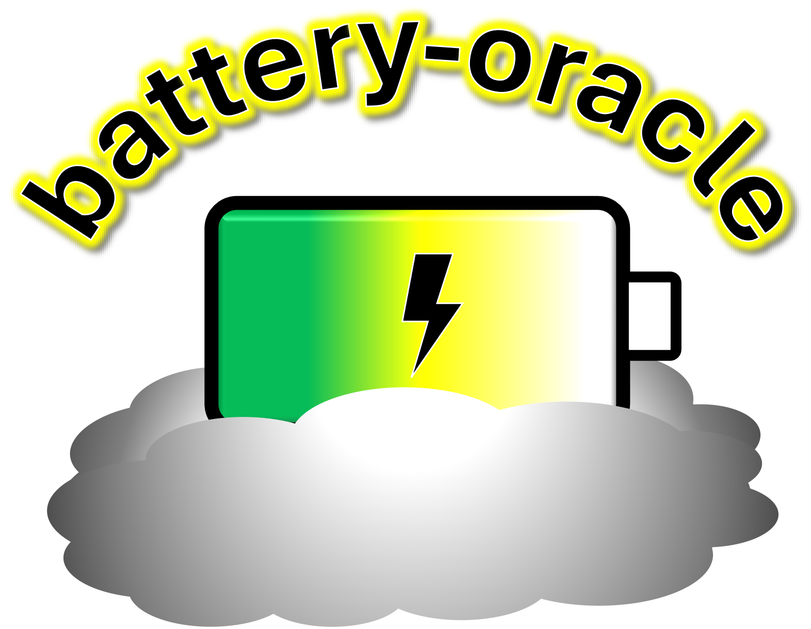

<p align="center">
  
</p>

# battery-oracle

[](https://github.com/TRustworthy-AI-Tools-for-Science/battery-oracle/actions/workflows/ci.yml)
[](https://trustworthy-ai-tools-for-science.github.io/battery-oracle/)
[](https://www.python.org/downloads/)
[](LICENSE)
[](https://www.pybamm.org/)
[](https://github.com/astral-sh/ruff)
[](https://pypi.org/project/battery-oracle/)

A stateful PyBaMM battery oracle. Given a 6-D charge/discharge protocol, it runs one
cycle of PyBaMM's Doyle–Fuller–Newman (DFN) model continuing from the previous call's
solution, synthesises an impedance spectrum after the discharged and the charged rest,
and fits an equivalent-circuit model (ECM) to each. It returns the same kind of
featurised state a real cell would, with degradation (SEI growth, lithium plating,
dead lithium) accumulating across calls, so it can stand in for a cell in an
active-learning loop.

The optional `[fit]` extra adds the stage-A fit: the beginning-of-life DFN parameters
fitted to a cell's whole measured history with PyBOP, and physical-validity checks of
the fitted cell.

## Install

Python 3.12+, PyBaMM 26.10.

```bash
pip install "battery-oracle @ git+https://github.com/TRustworthy-AI-Tools-for-Science/battery-oracle.git"
```

For development, with [uv](https://docs.astral.sh/uv/):

```bash
uv sync                          # core + dev group (includes the [fit] and [notebook] extras)
uv sync --extra autoeis          # + Bayesian ECM fitting (AutoEIS)
```

| Extra      | Enables | Without it |
|------------|---------|------------|
| `autoeis`  | Bayesian ECM fitting with AutoEIS | the analytic Randles stub; posterior-std slots are NaN |
| `drt`      | DRT peaks (also needs hybrid-drt and Mittag-Leffler from git) | DRT peaks empty |
| `fit`      | `battery_oracle.fit` and non-stationary EIS (PyBOP, pinned commit) | no fitting; equilibrium EIS only |

See the [installation docs](https://trustworthy-ai-tools-for-science.github.io/battery-oracle/install.html)
for the PyBOP pin and the DRT libraries.

## Usage

```python
from battery_oracle import PyBaMMOracle, Protocol

oracle = PyBaMMOracle(degradation_preset="accelerated")   # a fresh cell, ready to call

protocol = Protocol(
    charge_current_1_mA=200.0, charge_current_2_mA=100.0,
    charge_duration_1_h=0.25, charge_duration_2_h=0.25,
    discharge_current_mA=100.0, discharge_duration_h=1.0,
)
result = oracle.run_cycle(protocol)     # one DFN cycle -> EIS -> ECM
print(result.soh, result.ecm_charge)
```

`run_cycle` returns a `CycleResult` (`soh`, `soc_charge`, `soc_discharge`,
`capacity_ah`, `eis_charge`/`eis_discharge`, `ecm_charge`/`ecm_discharge` and their
posterior std, `protocol_applied`, ...). `oracle(u)` takes a protocol or a plain array
and returns only the state vector: the ECM posterior medians of both spectra followed
by their posterior standard deviations (length 4P for a P-parameter circuit, plus
`T_cell_K` with lumped thermal). Slice it by name with `oracle.state_vector_schema`.

Settings live in `OracleConfig` (one default each) and can be passed as keywords, an
`OracleConfig`, or an oracle YAML (`PyBaMMOracle.from_config("my_cell.yml")`). Pass the
circuit your experiment is featurised with (`circuit="R1-[R2,P3]-[R4,P5]"`); without
one the oracle uses `battery_oracle.DEFAULT_CIRCUIT`.

## Experiments from YAML

`config_experiment_defaults.yml` defines cycling, degradation, EIS, ECM and one or
more protocols, layered over the oracle YAML:

```python
from battery_oracle import run_experiment
history = run_experiment()                     # the packaged experiment
history = run_experiment("my_experiment.yml")  # your own
```

## Documentation

Guides (the model, protocols, degradation, divergences from stock PyBaMM, numerical
stability, physical validity, stage-A fitting) and the API reference:
**<https://trustworthy-ai-tools-for-science.github.io/battery-oracle/>**.

## Downstream

Calibration of the degradation scales to measured ageing, CSV export, plots and the
Kramers–Kronig analysis pipeline live in `battery-forecast`
(`battery_forecast.oracle_tune`, `battery_forecast.oracle_checks`).

## Physics scope

Know what the oracle models before trusting it beyond a demonstration or
active-learning role:

- Two parameter sets are supported: `Chen2020` (LG M50, NMC811/graphite, 5 Ah;
  default) and `LiR2032` (the jones2022 LiCoO2/graphite coin cell, built on Ai2020).
  Other PyBaMM sets lack the SEI parameters the degradation model needs and are
  rejected.
- The degradation presets (`nominal` = SEI, `accelerated` = SEI + lithium plating) use
  published values (`battery_oracle.degradation`, `parameter_sets.LIR2032_SEI`); their
  rates are calibrated to a dataset downstream (battery-forecast Stage B).
- Particle cracking and SEI on cracks are disabled in every preset (reasons in
  `battery_oracle.degradation`). Capacity fade comes from SEI
  growth and lithium plating; an optional, off-by-default `dod_lam_scale` term
  approximates depth-of-discharge-driven active-material loss.
- Protocol currents are clipped to C-rate bounds of the simulated cell (0.01C to
  1.5C by default; `protocol_bounds.c_*_crate`).
- The default (equilibrium) EIS model has no degradation submodels; degradation
  enters the spectrum as a series film resistance and a reduced active-material
  fraction. Non-stationary EIS (`eis_mode="nonstationary"`) linearises the cycling
  model during the sweep instead.

## License

MIT
